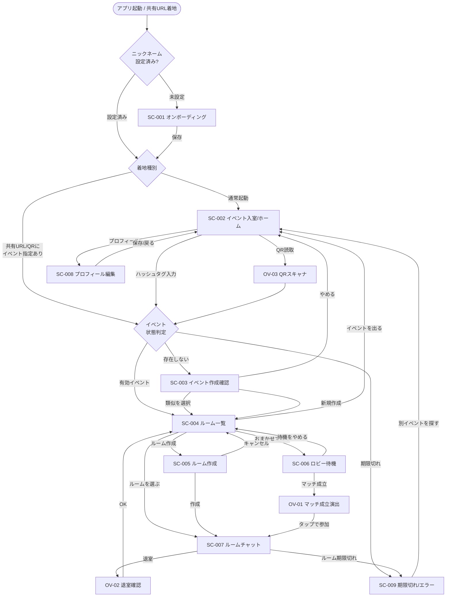
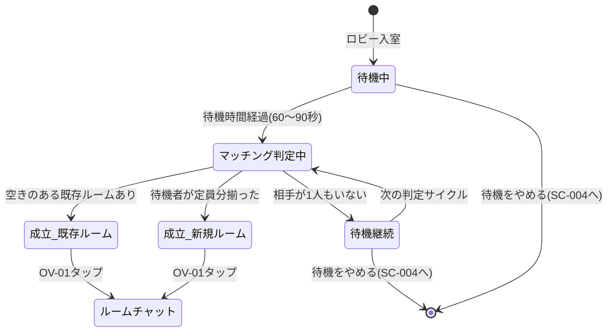
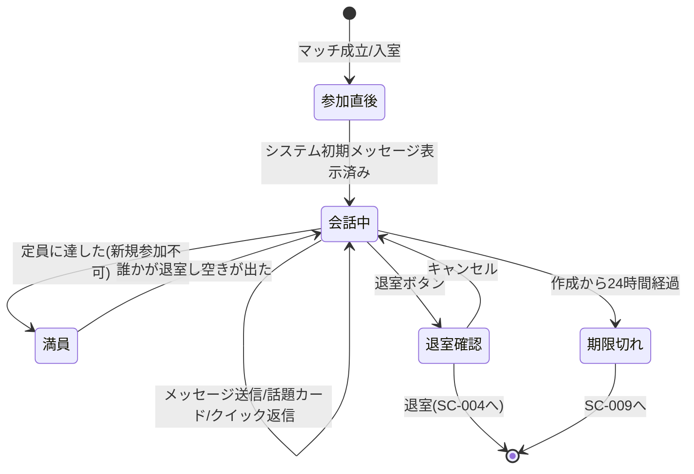

# Bocchi 画面フロー設計書

- 作成日: 2026-07-08
- 対象: 懇親会ぼっち回避アプリ「Bocchi」MVP（v1）
- 前提文書: `docs/product-discovery.md`（企画）、`docs/interview-decisions.md`（決定事項 D1〜D8）、`AGENTS.md`（技術方針）
- 対象デバイス: スマートフォンのブラウザ（モバイル Web、縦画面前提）。PC ブラウザでも破綻しないが最適化対象外
- 認証: なし。ニックネームのみ端末ローカル保存（D6）
- 本書の位置づけ: 実装着手前の確定仕様の文書化。画面一覧・遷移図・画面仕様書・主要フロー・エッジケース・簡易ワイヤーフレームを含む

---

## 0. 用語と前提

| 用語                 | 定義                                                                                                              |
| -------------------- | ----------------------------------------------------------------------------------------------------------------- |
| イベント             | 1 つの懇親会・カンファレンスに対応する箱。ハッシュタグ風の名前で識別。作成から 24 時間で自動期限切れ（D7）        |
| ルーム               | イベント内のトークグループ。1 人でも作成・入室可。定員 2〜6 人（デフォルト 3 人、D5）。作成から 24 時間で期限切れ |
| ロビー               | ルームを自分で選ばない受動的な参加者が待機する場所。60〜90 秒待機で自動マッチング（D3）                           |
| マッチ成立           | 自動マッチングでルームに割り当てられ、ルームチャットが開いた状態。システムが最初のメッセージを自動投稿（D4）      |
| 話題カード           | アイスブレイクのお題を提示するカード（D7）                                                                        |
| ローカルプロフィール | 端末 localStorage に保存するニックネーム＋任意の X アカウント（D6）                                               |

**通知方針（重要・D7）**: Web Push は MVP に含めない。マッチ成立などの気づきは「画面内の目立つ表示・効果音・バイブレーション」で代用する。ユーザーは画面を開いたまま待つ前提とする。したがってロビーやチャットの待機画面は、バックグラウンド前提の設計をしない。

**要件 ID の対応**: 本書では決定事項 D1〜D8 を要件 ID として参照する（例: D2 = イベント入室、D3 = マッチング構造）。

---

## 1. 画面一覧表

権限区分は認証がないため「全ユーザー（ゲスト）」が基本。ニックネーム未設定かどうかで一部画面のアクセス可否が変わるため、その条件を権限欄に記す。

| 画面ID | 画面名                                     | 概要                                                                             | 対応要件ID | アクセス条件                       |
| ------ | ------------------------------------------ | -------------------------------------------------------------------------------- | ---------- | ---------------------------------- |
| SC-001 | オンボーディング（ニックネーム入力）       | 初回起動時にニックネームを入力し端末に保存する                                   | D6         | ニックネーム未設定の全ユーザー     |
| SC-002 | イベント入室 / ホーム                      | ハッシュタグ入力・共有 URL 着地・QR 読取からイベントに入る起点                   | D2         | 全ユーザー（ニックネーム設定済み） |
| SC-003 | イベント作成確認（正規化・類似サジェスト） | 該当イベントがない場合、正規化名の提示・類似イベントのサジェスト・新規作成の確認 | D2         | 全ユーザー                         |
| SC-004 | ルーム一覧（イベントホーム）               | イベント内のルームを一覧表示し、選んで入室・新規作成・ロビー待機へ分岐           | D3         | 全ユーザー（当該イベントが有効）   |
| SC-005 | ルーム作成                                 | ルーム名・定員（2〜6、既定 3）を指定してルームを作成する                         | D3, D5     | 全ユーザー                         |
| SC-006 | ロビー待機                                 | 自動マッチング待機。待機人数表示、60〜90 秒でマッチング実行                      | D3         | 全ユーザー                         |
| SC-007 | ルームチャット                             | 集合場所を相談して物理合流。システム初期メッセージ・クイック返信・話題カード     | D4, D7     | 当該ルームの参加者                 |
| SC-008 | プロフィール編集                           | ニックネーム・任意の X アカウントの編集                                          | D6         | 全ユーザー                         |
| SC-009 | 期限切れ / エラー                          | 期限切れイベント・ルームの URL を開いた場合や不正 URL の着地先                   | D7         | 全ユーザー                         |

補助的な UI（画面遷移を伴わないモーダル・オーバーレイ）:

| 要素ID | 名称                   | 概要                                                                                       | 対応要件ID |
| ------ | ---------------------- | ------------------------------------------------------------------------------------------ | ---------- |
| OV-01  | マッチ成立オーバーレイ | ロビーでマッチ成立時に全画面で気づかせる演出（表示＋音＋バイブ）。タップでルームチャットへ | D3, D4, D7 |
| OV-02  | 退室確認ダイアログ     | ルーム・ロビーから離脱する際の確認                                                         | D3         |
| OV-03  | QR コードスキャナ      | カメラで共有 QR を読み取るオーバーレイ                                                     | D2         |
| OV-04  | 話題カード表示         | チャット内でお題カードを引く／表示するボトムシート                                         | D7         |

---

## 2. 画面遷移図（Mermaid）

### 2.1 全体フロー（flowchart）



### 2.2 ロビー待機の状態遷移（stateDiagram-v2）

ロビー内部は待機・マッチング・成立という時間経過を伴うモードを持つため状態遷移で表す。



### 2.3 ルームチャットの状態遷移（stateDiagram-v2）



---

## 3. 画面仕様書

各画面につき、レイアウト概要・表示項目・バリデーション・アクション・5 状態（正常／空データ／ローディング／エラー／権限なし）を定義する。データソースは想定スキーマのテーブル名で示す（実装時に確定。標準 Postgres として持ち出せるよう素の SQL マイグレーションで管理する方針＝D8）。

想定エンティティ（参考）: `events`, `rooms`, `room_members`, `messages`, `topic_cards`。プロフィールは端末 localStorage（`profile.nickname`, `profile.x_account`, ユーザー識別用の `profile.client_id`）。

---

### SC-001 オンボーディング（ニックネーム入力）

初回起動、またはニックネーム未設定の状態でアプリに来たときに最初に表示する。認証は行わず、入力値は端末ローカルに保存する（D6）。

#### 画面レイアウト概要

- ヘッダー: アプリ名「Bocchi」とワンライナー説明（例: 「同じ懇親会の“今ひとり”な人とつながる」）
- 本文: ニックネーム入力欄、X アカウント入力欄（任意）、補足文（この情報は端末にだけ保存される旨）
- フッター: 「はじめる」ボタン（プライマリ、全幅）

#### 表示項目定義

| 項目名         | 型       | 桁数 | 必須 | 初期値   | データソース                                                      |
| -------------- | -------- | ---- | ---- | -------- | ----------------------------------------------------------------- |
| ニックネーム   | 文字列   | 20   | 必須 | 空       | localStorage `profile.nickname`                                   |
| X アカウント   | 文字列   | 16   | 任意 | 空       | localStorage `profile.x_account`（@ 記号は自動補完/除去して保持） |
| 保存先の説明文 | 表示のみ | -    | -    | 固定文言 | -                                                                 |

#### 入力バリデーション

| 項目名       | 条件                                        | メッセージ例                                                                                 |
| ------------ | ------------------------------------------- | -------------------------------------------------------------------------------------------- |
| ニックネーム | 未入力不可                                  | 「ニックネームを入力してください（未入力です）」                                             |
| ニックネーム | 20 文字以内                                 | 「ニックネームは 20 文字以内で入力してください」                                             |
| ニックネーム | 空白のみ不可                                | 「ニックネームに空白以外の文字を入力してください」                                           |
| X アカウント | 半角英数字とアンダースコアのみ・16 文字以内 | 「X のユーザー名は半角英数字とアンダースコア 16 文字以内で入力してください（@ は不要です）」 |

#### アクション定義

| ボタン/イベント | 発火条件 | 処理内容                                                             | 遷移先                                                                    |
| --------------- | -------- | -------------------------------------------------------------------- | ------------------------------------------------------------------------- |
| はじめる        | クリック | バリデーション後、localStorage に保存し `client_id` を未発行なら発行 | 直前に開こうとしていたイベントがあればそのイベント解決へ、なければ SC-002 |

#### 状態定義

| 状態         | 表示内容                                                                                                                                                                                              |
| ------------ | ----------------------------------------------------------------------------------------------------------------------------------------------------------------------------------------------------- |
| 正常         | 入力欄を表示し編集可能                                                                                                                                                                                |
| 空データ     | 該当なし（保存前の初期表示が実質の空状態。プレースホルダで入力を促す）                                                                                                                                |
| ローディング | 保存は同期的でほぼ一瞬のため通常は無し。共有 URL 経由でイベント解決へ進む場合のみボタンをローディング表示にして二重遷移を防止                                                                         |
| エラー       | localStorage が使用不可（プライベートブラウズ等）の場合、「お使いのブラウザでは設定を保存できません。プライベートモードを解除してお試しください」を表示。セッション内メモリで暫定続行できるようにする |
| 権限なし     | 該当なし（認証がないため権限の概念なし）                                                                                                                                                              |

---

### SC-002 イベント入室 / ホーム

ニックネーム設定済みユーザーの通常の起点。イベントへの 3 経路（共有 URL 着地・QR 読取・ハッシュタグ手入力）を集約する。主経路は共有 URL / QR（D2）。

#### 画面レイアウト概要

- ヘッダー: アプリ名、右上にプロフィールアイコン（→ SC-008）
- 本文: 「イベントに入る」見出し、ハッシュタグ入力欄、「QR を読み取る」ボタン、直近に入ったイベント履歴（あれば数件）
- 補足: 入室のしくみの一言説明（「URL や QR で入るのがいちばん簡単です」）

#### 表示項目定義

| 項目名           | 型     | 桁数 | 必須       | 初期値       | データソース                                       |
| ---------------- | ------ | ---- | ---------- | ------------ | -------------------------------------------------- |
| ニックネーム表示 | 文字列 | 20   | -          | 保存値       | localStorage `profile.nickname`                    |
| ハッシュタグ入力 | 文字列 | 50   | 入力時必須 | 空           | ユーザー入力（照合前に正規化）                     |
| 最近のイベント   | リスト | -    | -          | 直近入室履歴 | localStorage `recent_events`（有効なもののみ表示） |

#### 入力バリデーション

| 項目名           | 条件                                           | メッセージ例                                             |
| ---------------- | ---------------------------------------------- | -------------------------------------------------------- |
| ハッシュタグ入力 | 未入力不可（入室実行時）                       | 「イベント名（ハッシュタグ）を入力してください」         |
| ハッシュタグ入力 | 50 文字以内                                    | 「イベント名は 50 文字以内で入力してください」           |
| ハッシュタグ入力 | 正規化後に空にならない（記号だけの入力を弾く） | 「使える文字（英数字・かな・漢字など）を含めてください」 |

#### アクション定義

| ボタン/イベント      | 発火条件         | 処理内容                       | 遷移先                                                   |
| -------------------- | ---------------- | ------------------------------ | -------------------------------------------------------- |
| 入室（→）            | ハッシュタグ確定 | 入力を正規化し `events` を照合 | 有効一致: SC-004 / 不一致: SC-003 / 期限切れ一致: SC-009 |
| QR を読み取る        | クリック         | OV-03 を開きカメラ起動         | 読取成功でイベント解決 → SC-004 / SC-003 / SC-009        |
| 最近のイベント項目   | クリック         | 当該イベントの有効性を確認     | 有効: SC-004 / 期限切れ: SC-009（履歴から除去）          |
| プロフィールアイコン | クリック         | -                              | SC-008                                                   |

#### 状態定義

| 状態         | 表示内容                                                                                                    |
| ------------ | ----------------------------------------------------------------------------------------------------------- |
| 正常         | 入力欄・QR ボタン・履歴を表示                                                                               |
| 空データ     | 「最近のイベント」が 0 件のときは履歴セクションを非表示にし、入力欄と QR ボタンのみ表示                     |
| ローディング | イベント照合中は入室ボタンをスピナー表示にし二重実行を防止                                                  |
| エラー       | 照合 API 通信失敗時「通信エラーが発生しました。時間をおいて再度お試しください」をトースト表示。入力値は保持 |
| 権限なし     | 該当なし                                                                                                    |

---

### SC-003 イベント作成確認（正規化・類似サジェスト）

入力・読取したイベントが存在しない場合に表示。表記ゆれによるイベント分裂（密度仮説の自壊）を防ぐため、正規化名の提示と類似イベントのサジェストを必須とする（D2）。

#### 画面レイアウト概要

- ヘッダー: 「このイベントはまだありません」
- 本文（上段）: 類似イベントのサジェストリスト（あれば）。各項目に名称・参加中の人数・残り有効時間
- 本文（下段）: 「新しく作る」カード。正規化後の表示名をプレビュー表示
- フッター: 「このまま作る」ボタン、「やめる」リンク

#### 表示項目定義

| 項目名             | 型     | 桁数 | 必須 | 初期値         | データソース                                                          |
| ------------------ | ------ | ---- | ---- | -------------- | --------------------------------------------------------------------- |
| 入力名（原文）     | 文字列 | 50   | -    | ユーザー入力値 | 直前入力                                                              |
| 正規化プレビュー名 | 文字列 | 50   | -    | 正規化結果     | クライアント/サーバ正規化ロジック（小文字化・全角半角統一・記号統一） |
| 類似イベント候補   | リスト | -    | -    | 照合結果       | `events`（正規化名の類似度上位・有効なもの）                          |
| 候補ごとの参加人数 | 数値   | -    | -    | 集計値         | `room_members` 集計                                                   |
| 候補ごとの残り時間 | 時間   | -    | -    | TTL 残         | `events.created_at` + 24h                                             |

#### 入力バリデーション

| 項目名             | 条件                                                 | メッセージ例                                                     |
| ------------------ | ---------------------------------------------------- | ---------------------------------------------------------------- |
| 正規化プレビュー名 | 正規化後に空でない                                   | 「この名前ではイベントを作れません。別の名前を入力してください」 |
| （作成時）同名重複 | 正規化名が既存と完全一致した場合は作成せず既存へ合流 | 「同じ名前のイベントが見つかりました。そちらに合流します」       |

#### アクション定義

| ボタン/イベント | 発火条件     | 処理内容                                                 | 遷移先 |
| --------------- | ------------ | -------------------------------------------------------- | ------ |
| 類似候補を選ぶ  | 候補クリック | その既存イベントに入室（合流を促す狙い）                 | SC-004 |
| このまま作る    | クリック     | 正規化名で `events` を upsert 作成し、作成者を入室させる | SC-004 |
| やめる          | クリック     | 作成せず戻る                                             | SC-002 |

#### 状態定義

| 状態         | 表示内容                                                                                                                                                                                        |
| ------------ | ----------------------------------------------------------------------------------------------------------------------------------------------------------------------------------------------- |
| 正常         | 正規化プレビューと（あれば）類似候補、作成ボタンを表示                                                                                                                                          |
| 空データ     | 類似候補が 0 件のときはサジェスト領域を「似たイベントは見つかりませんでした」とし、新規作成を主導線にする                                                                                       |
| ローディング | 類似検索中は候補領域をスケルトン表示。作成実行中は作成ボタンをローディング表示                                                                                                                  |
| エラー       | 作成 API が競合（同時に同名作成）した場合は既存へ合流させ「同じイベントが作成されたため、そちらに合流しました」を表示。通信失敗時は「通信エラーが発生しました。時間をおいて再度お試しください」 |
| 権限なし     | 該当なし                                                                                                                                                                                        |

---

### SC-004 ルーム一覧（イベントホーム）

イベントに入った後の中心画面。能動的な人はルームを選ぶ・作る、受動的な人はロビーで待つ、という分岐点（D3）。

#### 画面レイアウト概要

- ヘッダー: イベント名、右上にイベントの残り有効時間、戻る（イベントを出る）
- サブヘッダー: 「ロビーに ◯ 人が待機中」バナー（1 人でルームを作った人にも見せる＝D3）＋「おまかせで待つ」ボタン
- 本文: ルームカードのリスト（ルーム名・現在人数/定員・空き状況・話題タグ・残り時間）。空きのあるルームを上位に表示
- フローティングアクション: 「ルームを作る」ボタン（→ SC-005）

#### 表示項目定義

| 項目名           | 型     | 桁数 | 必須 | 初期値       | データソース                           |
| ---------------- | ------ | ---- | ---- | ------------ | -------------------------------------- |
| イベント名       | 文字列 | 50   | -    | 取得値       | `events.display_name`                  |
| イベント残り時間 | 時間   | -    | -    | 算出         | `events.created_at` + 24h              |
| ロビー待機人数   | 数値   | -    | -    | リアルタイム | ロビー待機者集計（Supabase Realtime）  |
| ルーム名         | 文字列 | 30   | -    | 取得値       | `rooms.name`                           |
| 現在人数 / 定員  | 数値   | -    | -    | 取得値       | `room_members` 集計 / `rooms.capacity` |
| 空き状況         | 状態   | -    | -    | 算出         | 定員 − 現在人数                        |
| ルーム残り時間   | 時間   | -    | -    | 算出         | `rooms.created_at` + 24h               |

#### 入力バリデーション

該当なし（表示・選択のみの画面。入力項目なし）。

#### アクション定義

| ボタン/イベント          | 発火条件 | 処理内容                                  | 遷移先             |
| ------------------------ | -------- | ----------------------------------------- | ------------------ |
| ルームカード（空きあり） | クリック | 当該ルームへ入室（`room_members` に追加） | SC-007             |
| ルームカード（満員）     | クリック | 入室不可。満員トーストを表示              | 遷移なし（同画面） |
| おまかせで待つ           | クリック | ロビーに待機登録                          | SC-006             |
| ルームを作る             | クリック | -                                         | SC-005             |
| イベントを出る           | クリック | イベントから離脱                          | SC-002             |

#### 状態定義

| 状態         | 表示内容                                                                                                                                              |
| ------------ | ----------------------------------------------------------------------------------------------------------------------------------------------------- |
| 正常         | ロビーバナーとルームカード一覧を表示。空きあり優先で並べる                                                                                            |
| 空データ     | ルームが 0 件のとき「まだルームがありません。最初のルームを作るか、おまかせで待ちましょう」と表示し、「ルームを作る」「おまかせで待つ」を主導線にする |
| ローディング | 初回取得時はルーム一覧をスケルトン表示。以降は Realtime 差分更新（全体スピナーは出さない）                                                            |
| エラー       | 一覧取得失敗時「ルーム一覧を取得できませんでした」＋再試行ボタン。Realtime 切断時は上部に「接続が切れました。再接続中…」バーを出し自動再接続          |
| 権限なし     | イベントが期限切れに変わった場合は SC-009 へ誘導（「このイベントは終了しました」）                                                                    |

---

### SC-005 ルーム作成

ルームを新規作成する。1 人でも作成・入室でき、作成時に定員を指定する（D3, D5）。

#### 画面レイアウト概要

- ヘッダー: 「ルームを作る」、戻る
- 本文: ルーム名入力欄、定員セレクタ（2〜6、既定 3）、話題タグ入力（任意）、補足文（「1 人でも大丈夫。作って待つと、あとから人が合流できます」）
- フッター: 「作る」ボタン（プライマリ）、「キャンセル」

#### 表示項目定義

| 項目名   | 型     | 桁数 | 必須 | 初期値                   | データソース             |
| -------- | ------ | ---- | ---- | ------------------------ | ------------------------ |
| ルーム名 | 文字列 | 30   | 任意 | 空（未入力時は自動命名） | `rooms.name`             |
| 定員     | 選択肢 | -    | 必須 | 3                        | `rooms.capacity`（2〜6） |
| 話題タグ | 文字列 | 20   | 任意 | 空                       | `rooms.topic_tag`        |

#### 入力バリデーション

| 項目名   | 条件        | メッセージ例                                 |
| -------- | ----------- | -------------------------------------------- |
| ルーム名 | 30 文字以内 | 「ルーム名は 30 文字以内で入力してください」 |
| 定員     | 2〜6 の範囲 | 「定員は 2〜6 人の範囲で選んでください」     |
| 話題タグ | 20 文字以内 | 「話題タグは 20 文字以内で入力してください」 |

未入力ルーム名は「◯◯さんのルーム」等でサーバ側自動命名（作成をブロックしない）。

#### アクション定義

| ボタン/イベント | 発火条件 | 処理内容                                                          | 遷移先                                  |
| --------------- | -------- | ----------------------------------------------------------------- | --------------------------------------- |
| 作る            | クリック | バリデーション後 `rooms` を作成し、作成者を `room_members` に追加 | 成功: SC-007 / 失敗: 同画面にエラー表示 |
| キャンセル      | クリック | 破棄                                                              | SC-004                                  |
| 戻る            | クリック | 入力があれば破棄確認、なければ戻る                                | SC-004                                  |

#### 状態定義

| 状態         | 表示内容                                                                                                                                                  |
| ------------ | --------------------------------------------------------------------------------------------------------------------------------------------------------- |
| 正常         | フォームを表示し編集可能                                                                                                                                  |
| 空データ     | 該当なし（新規作成フォームのため）                                                                                                                        |
| ローディング | 作成中は「作る」ボタンをローディング表示にし二重作成を防止                                                                                                |
| エラー       | 作成失敗時「ルームを作成できませんでした。時間をおいて再度お試しください」を上部に表示し、入力値を保持。イベントが作成直前に期限切れになった場合は SC-009 |
| 権限なし     | 該当なし                                                                                                                                                  |

---

### SC-006 ロビー待機

ルームを自分で選ばない受動的な参加者の待機画面。60〜90 秒待機で自動マッチングを実行する。優先順は「①空きのある既存ルーム → ②なければ待機者同士で新ルーム」（D3）。Web Push がないため、この画面は開いたまま待つ前提で、待機の手応え（人数・経過）を常に見せる（D7）。

#### 画面レイアウト概要

- ヘッダー: イベント名、「待機をやめる」
- 中央: 待機アニメーション、経過/目安時間、「ロビーに ◯ 人が待機中」
- 補足: 「空いているルームが見つかると自動で合流します。見つからなければ、待っている人同士でルームを作ります」
- フッター: 「自分でルームを選ぶ」リンク（SC-004 に戻す代替導線）

#### 表示項目定義

| 項目名           | 型   | 桁数 | 必須 | 初期値       | データソース                         |
| ---------------- | ---- | ---- | ---- | ------------ | ------------------------------------ |
| ロビー待機人数   | 数値 | -    | -    | リアルタイム | ロビー待機者集計（Realtime）         |
| 経過時間 / 目安  | 時間 | -    | -    | 算出         | 入室時刻からの経過（目安 60〜90 秒） |
| 待機ステータス文 | 表示 | -    | -    | 状態連動     | 状態機械（2.2）に対応                |

#### 入力バリデーション

該当なし（入力項目なし）。

#### アクション定義

| ボタン/イベント        | 発火条件     | 処理内容                              | 遷移先                               |
| ---------------------- | ------------ | ------------------------------------- | ------------------------------------ |
| （自動）マッチング判定 | 待機時間経過 | 空きルーム検索 → 割当 or 新ルーム作成 | 成立: OV-01 を表示 → タップで SC-007 |
| 待機をやめる           | クリック     | ロビー待機を解除                      | SC-004                               |
| 自分でルームを選ぶ     | クリック     | ロビー待機を解除                      | SC-004                               |

#### 状態定義

| 状態                       | 表示内容                                                                                                                                                                                            |
| -------------------------- | --------------------------------------------------------------------------------------------------------------------------------------------------------------------------------------------------- |
| 正常                       | 待機アニメーション・待機人数・経過を表示                                                                                                                                                            |
| 空データ（ロビー 0〜1 人） | 自分以外に待機者がおらず空きルームもない場合、待機を継続しつつ「まだ相手が見つかりません。空くのを待つか、自分でルームを作って受け皿になると合流されやすくなります」を表示し、SC-005 への導線を強調 |
| ローディング               | マッチング判定中は「相手を探しています…」を表示。判定は数秒で完了させる                                                                                                                             |
| エラー                     | Realtime 切断時「接続が切れました。再接続中…」を表示し自動再接続。復帰後に待機タイマーを継続。マッチング処理失敗時は待機を継続し次サイクルで再試行                                                  |
| 権限なし                   | イベント期限切れ時は待機を打ち切り SC-009 へ                                                                                                                                                        |

#### マッチ成立演出（OV-01・エッジケースの中核）

- Web Push なしでも気づけるよう、成立時に**全画面オーバーレイ＋効果音＋バイブレーション**（`navigator.vibrate`、対応端末のみ）で強く通知する（D7）。
- オーバーレイには「ルームが決まりました！」＋ルーム名＋参加人数、「参加する」ボタンを表示。タップで SC-007 へ。
- 音・バイブは端末やブラウザの制約で発火しない場合があるため、**視覚表現（全画面・色・動き）を主、音・バイブを従**とし、視覚だけで確実に気づける設計にする。
- ユーザーが一定時間反応しなくても割当は保持する（本人は既に `room_members` に入っている）。再度画面を見たときにオーバーレイが残っていて参加できる。

---

### SC-007 ルームチャット

マッチ成立・ルーム入室後の本体。集合場所を相談して物理合流する。チャットで止まらないよう、成立時にシステムが最初のメッセージ＋クイック返信候補を自動投稿する（D4）。話題カードでアイスブレイクを支援する（D7）。

#### 画面レイアウト概要

- ヘッダー: ルーム名、参加人数/定員、右上メニュー（退室・話題カード）
- 本文: メッセージリスト（システムメッセージ・参加者メッセージ）。相手のプロフィール（ニックネーム、任意の X アカウントはリンク表示）
- 直近アクション帯: クイック返信候補チップ（初期メッセージに紐づく）＋「話題カードを引く」ボタン
- フッター: メッセージ入力欄＋送信ボタン

#### 表示項目定義

| 項目名                 | 型     | 桁数 | 必須       | 初期値   | データソース                                                     |
| ---------------------- | ------ | ---- | ---------- | -------- | ---------------------------------------------------------------- |
| ルーム名               | 文字列 | 30   | -          | 取得値   | `rooms.name`                                                     |
| 参加人数 / 定員        | 数値   | -    | -          | 取得値   | `room_members` / `rooms.capacity`                                |
| 参加者ニックネーム     | 文字列 | 20   | -          | 取得値   | `room_members.nickname`                                          |
| 参加者 X アカウント    | 文字列 | 16   | 任意       | 取得値   | `room_members.x_account`（あればリンク）                         |
| メッセージ本文         | 文字列 | 500  | 送信時必須 | 空       | `messages.body`                                                  |
| システム初期メッセージ | 表示   | -    | -          | 自動投稿 | サーバ生成（集合相談を促す文＋クイック返信候補）                 |
| クイック返信候補       | 選択肢 | -    | -          | 定型     | 例: 「入口の近くにいます」「テーブル番号は？」「今どのあたり？」 |
| 話題カード             | 表示   | -    | -          | 引いた時 | `topic_cards`（ランダム抽出）                                    |

#### 入力バリデーション

| 項目名         | 条件         | メッセージ例                                     |
| -------------- | ------------ | ------------------------------------------------ |
| メッセージ本文 | 空送信不可   | 「メッセージを入力してください」                 |
| メッセージ本文 | 500 文字以内 | 「メッセージは 500 文字以内で入力してください」  |
| メッセージ本文 | 空白のみ不可 | 「メッセージに空白以外の文字を入力してください」 |

#### アクション定義

| ボタン/イベント    | 発火条件       | 処理内容                                                            | 遷移先                                  |
| ------------------ | -------------- | ------------------------------------------------------------------- | --------------------------------------- |
| 送信               | クリック/Enter | バリデーション後 `messages` に追加、Realtime で配信                 | 同画面（メッセージ追加）                |
| クイック返信チップ | クリック       | 定型文をそのまま送信                                                | 同画面                                  |
| 話題カードを引く   | クリック       | OV-04 を開き `topic_cards` からお題を提示。「みんなに送る」で共有可 | 同画面                                  |
| 退室               | クリック       | OV-02（退室確認）を表示                                             | OK で SC-004（`room_members` から除去） |
| X アカウントリンク | クリック       | 外部の X プロフィールを新規タブで開く                               | 外部遷移                                |

#### 状態定義

| 状態         | 表示内容                                                                                                                                                                                                                  |
| ------------ | ------------------------------------------------------------------------------------------------------------------------------------------------------------------------------------------------------------------------- |
| 正常         | メッセージ一覧・入力欄・クイック返信・話題カードを表示。参加直後はシステム初期メッセージが最上部に見える                                                                                                                  |
| 空データ     | ユーザー発言が 0 でも、システム初期メッセージとクイック返信候補が必ず出ているため実質的な空はない。1 人だけの状態では「まだあなただけです。合流する人を待ちましょう。話題カードで準備しておくのもおすすめです」を補助表示 |
| ローディング | 初回はメッセージ履歴をスケルトン表示。送信中は送信ボタンを一時無効化し二重送信を防止（楽観的表示で自分の発言は即時反映）                                                                                                  |
| エラー       | 送信失敗時、該当メッセージに「送信できませんでした・再送」を表示し入力内容を保持。Realtime 切断時は「接続が切れました。再接続中…」バーを表示し自動再接続、復帰後に差分同期                                                |
| 権限なし     | 当該ルームの参加者でない状態で URL 直開きした場合、空きがあれば参加確認、満員なら「このルームは満員です」（下記満員参照）。ルーム期限切れなら SC-009                                                                      |
| 満員         | 定員到達後の新規流入は入室不可とし「このルームは満員です。ほかのルームを探すか、待ってみましょう」＋ SC-004 導線。既存参加者の会話は継続                                                                                  |

---

### SC-008 プロフィール編集

ニックネームと任意の X アカウントを編集する（D6）。SC-001 と項目は同じだが、既存値の編集用途。

#### 画面レイアウト概要

- ヘッダー: 「プロフィール」、戻る
- 本文: ニックネーム入力欄、X アカウント入力欄、補足（端末保存の旨・変更は今後の入室に反映される旨）
- フッター: 「保存」ボタン

#### 表示項目定義

| 項目名       | 型     | 桁数 | 必須 | 初期値 | データソース                     |
| ------------ | ------ | ---- | ---- | ------ | -------------------------------- |
| ニックネーム | 文字列 | 20   | 必須 | 保存値 | localStorage `profile.nickname`  |
| X アカウント | 文字列 | 16   | 任意 | 保存値 | localStorage `profile.x_account` |

#### 入力バリデーション

SC-001 と同一（ニックネーム必須・20 文字以内・空白のみ不可、X アカウントは半角英数字とアンダースコア 16 文字以内）。

#### アクション定義

| ボタン/イベント | 発火条件 | 処理内容                             | 遷移先                         |
| --------------- | -------- | ------------------------------------ | ------------------------------ |
| 保存            | クリック | バリデーション後 localStorage を更新 | SC-002（保存済みトースト表示） |
| 戻る            | クリック | 変更があれば破棄確認、なければ戻る   | 直前画面                       |

#### 状態定義

| 状態         | 表示内容                                             |
| ------------ | ---------------------------------------------------- |
| 正常         | 既存値を入れたフォームを表示し編集可能               |
| 空データ     | 該当なし（既存値がある前提。無ければ SC-001 に相当） |
| ローディング | ほぼ同期のため通常なし                               |
| エラー       | localStorage 保存不可時は SC-001 と同じ文言で通知    |
| 権限なし     | 該当なし                                             |

**注記**: 既に参加中のルームがある状態でニックネームを変更した場合、そのルームの表示名に反映するかは実装判断。MVP では「次の入室から反映（進行中ルームは変えない）」を既定とし、混乱を避ける。

---

### SC-009 期限切れ / エラー

期限切れイベント・ルームの URL・QR を開いた場合や、不正な URL の着地先（D7）。密度仮説の観点から、古い箱に迷い込んだ人を新しい行動へ戻す導線を必ず用意する。

#### 画面レイアウト概要

- ヘッダー: なし（またはアプリ名のみ）
- 中央: 状況アイコン、見出し（原因別文言）、説明
- フッター: 主導線ボタン「別のイベントを探す」、副導線「新しく作る」

#### 表示項目定義

| 項目名         | 型     | 桁数 | 必須 | 初期値   | データソース                                     |
| -------------- | ------ | ---- | ---- | -------- | ------------------------------------------------ |
| 原因区分       | 表示   | -    | -    | 判定値   | ルーティング判定（期限切れ / 不存在 / 不正 URL） |
| 見出し・説明   | 表示   | -    | -    | 原因連動 | 固定文言                                         |
| 参考: 元の名前 | 文字列 | 50   | -    | あれば   | `events.display_name`（期限切れイベントの場合）  |

#### 入力バリデーション

該当なし。

#### アクション定義

| ボタン/イベント    | 発火条件 | 処理内容                             | 遷移先                    |
| ------------------ | -------- | ------------------------------------ | ------------------------- |
| 別のイベントを探す | クリック | ホームへ                             | SC-002                    |
| 新しく作る         | クリック | 元の名前があれば引き継いで作成確認へ | SC-003（なければ SC-002） |

#### 状態定義

| 状態                           | 表示内容                                                                                                                                                                         |
| ------------------------------ | -------------------------------------------------------------------------------------------------------------------------------------------------------------------------------- |
| 正常（＝エラー表示自体が目的） | 原因別に文言を出す。期限切れ:「このイベントは終了しました（24 時間で自動的に閉じます）」／不存在:「このイベントは見つかりませんでした」／不正 URL:「リンクが正しくないようです」 |
| 空データ                       | 該当なし                                                                                                                                                                         |
| ローディング                   | 原因判定中はスケルトン（一瞬）                                                                                                                                                   |
| エラー                         | 判定 API 失敗時は汎用文言「うまく開けませんでした。時間をおいて再度お試しください」＋再試行                                                                                      |
| 権限なし                       | 該当なし                                                                                                                                                                         |

---

## 4. 主要フローの詳細

### 4.1 初回入室フロー（新規ユーザーが共有 URL から来る）

1. X 等の共有リンク（`https://bocchi.example/e/{イベントslug}`）をタップ → アプリ着地
2. ニックネーム未設定 → **SC-001** を表示。開こうとしたイベントは保持
3. ニックネーム（＋任意 X）を入力し「はじめる」→ localStorage 保存、`client_id` 発行
4. 保持していたイベントを解決 → 有効なら **SC-004**、なければ **SC-003**、期限切れなら **SC-009**
5. 以降は再訪時 SC-001 をスキップし **SC-002** が起点になる

### 4.2 ルーム選択入室フロー（能動的な参加者）

1. **SC-004** でルーム一覧を見る（空きあり優先で並ぶ）
2. 空きのあるルームカードをタップ → `room_members` に追加され **SC-007** へ
3. SC-007 で集合場所を相談。満員のルームをタップした場合は入室せず満員トースト（同画面）
4. 合流したら退室 → OV-02 確認 → SC-004（別のルームやイベントに戻れる）

### 4.3 ロビー待機 → 自動マッチ成立フロー（受動的な参加者）

1. **SC-004** で「おまかせで待つ」→ **SC-006** に待機登録
2. 「ロビーに ◯ 人待機中」と経過を表示しながら 60〜90 秒待機
3. 待機時間経過で判定（状態遷移 2.2）:
   - **① 空きのある既存ルームがある** → そのルームへ割当（既存ルーム優先＝D3）
   - **② 空きルームがなく待機者が定員分揃った** → 待機者同士で新ルーム作成
   - **③ 相手が 1 人もいない** → 待機継続（次サイクルで再判定。SC-005 で受け皿を作る導線を強調）
4. 成立時 **OV-01**（全画面＋音＋バイブ）で強く通知（D7）
5. 「参加する」タップで **SC-007** へ。システム初期メッセージ＋クイック返信が既に投稿済み（D4）

### 4.4 チャット → 合流完了フロー

1. **SC-007** 参加直後、システム初期メッセージ「集合場所を決めましょう。今どのあたりにいますか？」＋クイック返信候補が最上部に見える（D4）
2. クイック返信チップ（例「入口の近くにいます」）や自由入力で相談
3. 会話が固まらないよう「話題カードを引く」でアイスブレイク（D7）
4. 物理的に合流できたら退室 → OV-02 → SC-004。MVP では「合流できたか」の明示的完了ボタンは持たず、退室＝実質の完了とする（過剰な操作を避ける。将来 KPI 計測のため任意フィードバックを追加検討）

### 4.5 イベント / ルーム期限切れ時の挙動（D7）

- **URL を開いた時点で期限切れ**: ルーティングで判定し **SC-009**（原因「終了しました」）。`recent_events` 履歴からも除去
- **利用中にイベントが期限切れになった**: SC-004 / SC-006 で Realtime 検知 →「このイベントは終了しました」を表示し SC-009 または SC-002 へ誘導
- **利用中にルームが期限切れになった**: SC-007 で検知 → チャットをリードオンリー化し「このルームは終了しました」→ SC-009 / SC-004 へ
- TTL は「作成から 24 時間」。イベント配下のルームはイベントより先に切れることも遅れることもあるため、両方を独立に判定する

---

## 5. エッジケース・特殊状態の一覧

主要なエッジケースを横断的に整理する（各画面の状態定義と対応）。

| #   | シナリオ                                          | 発生画面                 | 挙動                                                                                                 |
| --- | ------------------------------------------------- | ------------------------ | ---------------------------------------------------------------------------------------------------- |
| E1  | ロビーに自分しかいない（0〜1 人）・空きルームなし | SC-006                   | 待機継続＋「自分でルームを作ると受け皿になれる」導線を強調（SC-005）。コールドスタート＝密度仮説対策 |
| E2  | 満員ルームをタップ / 満員ルーム URL を直開き      | SC-004 / SC-007          | 入室不可、「満員です」＋別ルーム・待機導線。既存参加者の会話は継続                                   |
| E3  | マッチ成立に気づかない（Push なし）               | OV-01                    | 全画面表示を主・音/バイブを従で強通知。無反応でも割当は保持し、再表示時に参加可能（D7）              |
| E4  | 期限切れイベント / ルームの URL を開く            | SC-009                   | 原因別文言＋「別のイベントを探す」「新しく作る」。履歴から除去                                       |
| E5  | 表記ゆれで同じ勉強会が別イベントに分裂しそう      | SC-003                   | 正規化プレビュー＋類似サジェストで既存合流を促す（D2、密度自壊防止）                                 |
| E6  | 同名イベントの同時作成（競合）                    | SC-003                   | 正規化名でサーバ側 upsert。競合時は既存へ合流させ通知                                                |
| E7  | localStorage 使用不可（プライベートブラウズ等）   | SC-001 / SC-008          | 保存不可を通知しセッション内メモリで暫定続行                                                         |
| E8  | Realtime 接続断・再接続                           | SC-004 / SC-006 / SC-007 | 「接続が切れました。再接続中…」バー＋自動再接続。復帰後に差分同期。ロビーは待機タイマー継続          |
| E9  | チャットで会話が止まる                            | SC-007                   | システム初期メッセージ＋クイック返信＋話題カードで着火（D4, D7）                                     |
| E10 | 1 人でルームを作って待つ                          | SC-004 / SC-007          | 1 人作成・入室可。SC-004 のロビー待機人数バナーを本人にも見せ、合流が近いことを可視化（D3）          |
| E11 | ニックネーム未設定で共有 URL 着地                 | SC-001                   | オンボーディング後、保持したイベントへ自動遷移（4.1）                                                |
| E12 | 送信直後に通信失敗                                | SC-007                   | 該当メッセージに再送 UI、入力保持。楽観表示は取り消さず再送で解決                                    |

---

## 6. 簡易ワイヤーフレーム（ASCII）

主要 5 画面のスマホ縦画面イメージ。寸法は目安。

### SC-002 イベント入室 / ホーム

```
┌──────────────────────────┐
│ Bocchi              (👤)  │  ← 右上プロフィール
│                          │
│  イベントに入る           │
│  ┌────────────────────┐  │
│  │ #イベント名を入力    │→ │  ← ハッシュタグ入力＋入室
│  └────────────────────┘  │
│  ┌────────────────────┐  │
│  │   [ QR を読み取る ]  │  │
│  └────────────────────┘  │
│                          │
│  最近のイベント           │
│   ・#techconf懇親会  (有効)│
│   ・#devmeetup       (有効)│
│                          │
│  URLやQRで入るのが簡単です │
└──────────────────────────┘
```

### SC-003 イベント作成確認

```
┌──────────────────────────┐
│ このイベントはまだありません │
│                          │
│  似ているイベント          │
│  ┌────────────────────┐  │
│  │ #techconf懇親会      │  │
│  │ 8人参加 / 残り 5時間  │→ │  ← 既存への合流を促す
│  └────────────────────┘  │
│                          │
│  新しく作る               │
│  作成名: #techconf懇親会   │  ← 正規化プレビュー
│  ┌────────────────────┐  │
│  │   [ このまま作る ]   │  │
│  └────────────────────┘  │
│         やめる            │
└──────────────────────────┘
```

### SC-004 ルーム一覧

```
┌──────────────────────────┐
│ ← #techconf懇親会  残り5h  │
│ ┌──────────────────────┐ │
│ │ ロビーに 4人 待機中   │ │
│ │      [ おまかせで待つ ]│ │
│ └──────────────────────┘ │
│                          │
│ ┌──────────────────────┐ │
│ │ ぼっち避難所      2/3 │→│  ← 空きあり(上位)
│ │ #初参加  残り4h       │ │
│ └──────────────────────┘ │
│ ┌──────────────────────┐ │
│ │ Go言語の人たち   3/3 満│ │  ← 満員
│ └──────────────────────┘ │
│                   (＋作る)│  ← FAB
└──────────────────────────┘
```

### SC-006 ロビー待機（＋ OV-01 成立演出）

```
┌──────────────────────────┐        ┌──────────────────────────┐
│ #techconf懇親会  待機やめる │        │██████ マッチ成立！ ██████ │
│                          │        │                          │
│         (( ◯ ))          │        │   ルームが決まりました！   │
│      相手を探しています…   │  →成立→ │   「ぼっち避難所」 3人     │
│                          │        │                          │
│   ロビーに 4人 待機中      │        │   ┌──────────────────┐   │
│                          │        │   │    [ 参加する ]    │   │
│  空きが出れば自動で合流／   │        │   └──────────────────┘   │
│  いなければ待機者で作ります │        │   ♪ 音 + バイブで通知      │
│                          │        │                          │
│     自分でルームを選ぶ     │        │██████████████████████████ │
└──────────────────────────┘        └──────────────────────────┘
```

### SC-007 ルームチャット

```
┌──────────────────────────┐
│ ← ぼっち避難所  2/3   (⋮)  │
│ ┌──────────────────────┐ │
│ │[system] 集合場所を決め │ │  ← 自動初期メッセージ(D4)
│ │ ましょう。今どのあたり？│ │
│ └──────────────────────┘ │
│  ┌ たろう(@taro_dev) ─┐   │
│  │ 入口の近くにいます   │   │
│  └────────────────────┘   │
│                          │
│ [入口近く][テーブル番号?] │  ← クイック返信
│ [ 🃏 話題カードを引く ]   │
│ ┌────────────────────┐ ▶ │  ← 入力＋送信
│ │ メッセージを入力      │   │
│ └────────────────────┘   │
└──────────────────────────┘
```

---

## 7. 整合性チェック / 品質チェックリスト

- [x] すべての画面に画面 ID を付与し、一覧表・遷移図・仕様書で一致
- [x] すべての画面を要件 ID（D1〜D8）に紐付け
- [x] 各画面にアクセス条件（認証なしのため権限区分は簡略）を明記
- [x] 遷移図にハッピーパス＋キャンセル・エラー・期限切れ遷移を含む
- [x] 表示項目ごとに型・桁数・必須/任意・初期値・データソースを定義
- [x] バリデーションを「何が悪いか＋どうすればよいか」形式で記述
- [x] すべてのアクションに遷移先を明記し遷移図と整合
- [x] 正常・空データ・ローディング・エラー・権限なしの 5 状態を全画面で検討（該当なしは理由付き）
- [x] 画面数 9＋オーバーレイ 4 を機能フロー単位で章立て・サブグラフ化
- [x] Push なし前提のマッチ気づき演出（OV-01）をエッジケースの中核として明記（D7）

## 8. 本設計での重要な判断（設計判断メモ）

1. **通知は画面内演出で代替**: Web Push を持たない制約（D7）に対し、OV-01 を「視覚を主・音/バイブを従」で設計。ロビー/チャットはバックグラウンド前提にしない。
2. **密度自壊の防止を SC-003 に集約**: 正規化プレビュー＋類似サジェスト＋同名 upsert 合流で、表記ゆれによるイベント分裂を入口で止める（D2、密度仮説対策）。
3. **1 人でも成立する導線**: SC-005 で 1 人作成可・SC-004 のロビー人数バナーを本人にも表示し、コールドスタート下でも「受け皿を作って待つ」行動を促す（D3, E1/E10）。
4. **会話が止まらない初動**: SC-007 はシステム初期メッセージ＋クイック返信＋話題カードを標準装備し、実質的な空チャット状態を作らない（D4, D7）。
5. **過剰な完了操作を持たない**: 合流の「完了ボタン」は MVP に置かず、退室＝完了とみなす。KPI（合流率）計測は任意フィードバックで将来拡張。
6. **移植性への配慮**: データソースは素の Postgres テーブル前提で記述し、Supabase 固有機能（Realtime 等）はアダプター層越しに使う前提（D8）。本書は UI 仕様に閉じ、実装の結合点を作らない。
